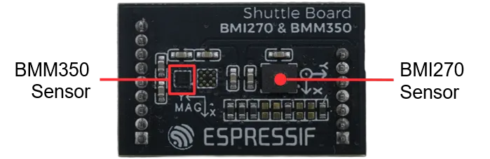

.. _bosch_bmi270_bmm350_shuttle:

BMI270 and BMM350 Shuttle Board
###############################

Overview
********

The BMI270 and BMM350 shuttle board is a Shuttle Board 3.0 daughterboard shipped with the
:zephyr:board:`esp_sensairshuttle` kit. It carries a `Bosch BMI270`_ 6-axis IMU and a
`Bosch BMM350`_ 3-axis magnetometer, both connected over I2C.

   BMI270 and BMM350 Shuttle Board (Credit: Espressif)

Requirements
************

The target board must define a ``zephyr_i2c`` node label for the I2C bus routed to the
Shuttle Board connector. See :ref:`shields` for more details.

The BMI270 selects SPI mode on any rising edge of its CS pin, until the next power cycle.
The shuttle CS line must be left high, which the mainboard pull-up provides.

Pin Assignments
===============

+-------------+-------------------------------------+
| Shuttle Pin | Function                            |
+=============+=====================================+
| SCK/SCL     | I2C SCL                             |
+-------------+-------------------------------------+
| SDI/SDA     | I2C SDA                             |
+-------------+-------------------------------------+
| SDO         | BMI270 address select (0x69 high)   |
+-------------+-------------------------------------+
| CS          | BMI270 interface select (high: I2C) |
+-------------+-------------------------------------+
| IMU_INT     | BMI270 INT1 interrupt               |
+-------------+-------------------------------------+
| BMM_INT     | BMM350 interrupt                    |
+-------------+-------------------------------------+

The BMI270 is at I2C address 0x69 and the BMM350 at 0x14.

On :zephyr:board:`esp_sensairshuttle`, IMU_INT is routed to GPIO0 and is described as the BMI270
interrupt. The driver uses INT1 for the any-motion trigger, which needs the ``bosch,bmi270-base``
feature set. BMM_INT is not routed to the SoC, so the BMM350 is used in polling mode.

See :dtcompatible:`bosch,bmi270` and :dtcompatible:`bosch,bmm350` for details on possible
devicetree settings.

Programming
***********

Set ``--shield bosch_bmi270_bmm350_shuttle`` when you invoke ``west build``. For example:

.. zephyr-app-commands::
   :zephyr-app: samples/sensor/accel_polling
   :board: esp_sensairshuttle/esp32c5/hpcore
   :shield: bosch_bmi270_bmm350_shuttle
   :goals: build

.. _Bosch BMI270:
   https://www.bosch-sensortec.com/products/motion-sensors/imus/bmi270/

.. _Bosch BMM350:
   https://www.bosch-sensortec.com/products/motion-sensors/magnetometers/bmm350/
